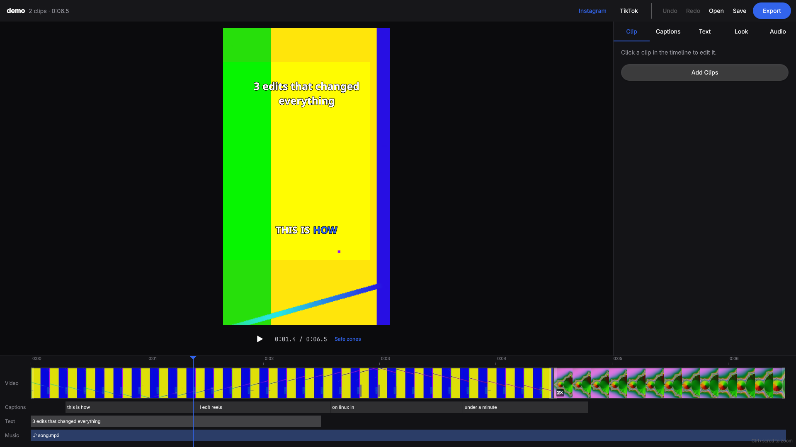

# Reelcut

Make vertical reels for Instagram and TikTok on Omarchy: cut your clips, caption them automatically, give them a look, add music, and export an MP4 that's ready to post.



## What it does

- **Cut**: drop in videos, split at the playhead, trim with the handles, reorder, change speed from 0.25× to 4×.
- **Frame**: every clip fills the 9:16 frame; zoom and pan landscape footage to pick what shows.
- **Cut silences**: one click removes the pauses from a talking clip.
- **Captions**: transcribed on your computer with whisper.cpp, word by word, in four styles (highlight the spoken word, pop one word at a time, bold, or on a box). Click any word to fix it.
- **Text**: hook titles that pop, fade or slide in.
- **Look**: exposure, contrast, saturation and temperature, six presets, and any `.cube` LUT (including ones from DaVinci Resolve).
- **Music**: a music track that ducks under speech, and loudness leveled to -14 LUFS.
- **Export**: 1080×1920, 30 fps, H.264 and AAC, on the GPU with NVENC when there is one. The preview shows each platform's safe zones so captions don't end up under the buttons.

Projects save as `.reel` files next to your media; the original videos are never changed.

## Install

```sh
bin/install
```

Captions need whisper.cpp, which downloads a 148 MB speech model the first time:

```sh
omarchy-pkg-add whisper-cpp
```

## Shortcuts

| Key | Action |
| --- | --- |
| Space | Play / pause |
| S | Split at playhead |
| ← / → | Step a frame (Shift: a second) |
| Home / End | Go to start / end |
| Delete | Delete the selected clip |
| Alt+← / Alt+→ | Move the selected clip |
| I | Add clips |
| T | Add text at the playhead |
| G | Show or hide safe zones |
| Ctrl+Z / Ctrl+Shift+Z | Undo / redo |
| Ctrl+S / Ctrl+Shift+S | Save / save as |
| Ctrl+O | Open a project |
| Ctrl+E | Export |
| Ctrl+scroll | Zoom the timeline |
| ? | Show shortcuts |
| Q | Quit |

## From the command line

```sh
reelcut clip1.mp4 clip2.mov        # open the editor with these clips
reelcut my.reel                    # open a project
reelcut export my.reel out.mp4     # render without the window (add --json for scripts)
```

## Development

```sh
bin/build    # build/reelcut
bin/test     # unit tests, plus real ffmpeg exports
```

`REELCUT_GRAB=shot.png REELCUT_GRAB_AT=2 build/reelcut demo.reel` saves a screenshot of the window after a few seconds and quits.
